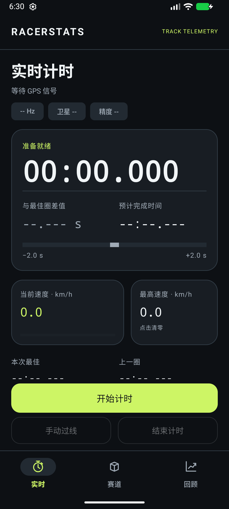
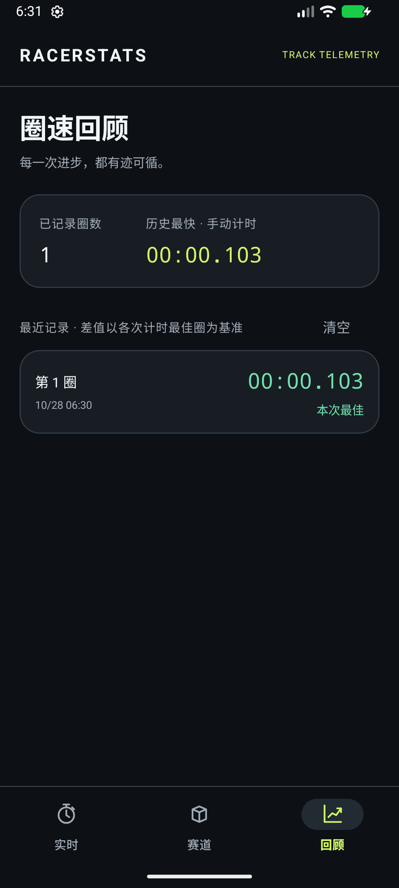

# RacerStats 🏁

原生 Android 赛道计时与 GPS 轨迹记录应用，使用 Kotlin、ViewModel、Room、Hilt 和 Google Maps。

## 当前功能

- **手动圈速计时**：开始、暂停、继续、手动过线、结束；使用单调时钟，暂停时间不会计入圈速。
- **实时仪表盘**：GPS 速度、最高速度、实际定位更新频率、卫星和精度信息。
- **参考圈对比**：完成有有效 GPS 轨迹的首圈后，按距离插值计算 Delta，按当前速度预测剩余时间。无参考数据时显示占位符。
- **圈速回顾**：自动保留最近 500 条已完成圈速，按每次计时的最佳圈显示差值；重启后仍可查看。
- **赛道管理**：录制轨迹、暂停/继续、在地图上设置起终点线、保存、查看、重命名和删除赛道。
- **深色界面**：固定计时操作区、可滚动的仪表盘、窄屏自适应数字和清晰的空状态。

## 构建

需要 **JDK 17**、Android SDK 34 和 Android SDK Build Tools 34。最低运行版本为 **Android 8.0 / API 26**。

```sh
git clone https://github.com/shaojun366/RacerStats.git
cd RacerStats
./gradlew assembleDebug
```

Windows 使用 `gradlew.bat`。通过 `JAVA_HOME` 或 Android Studio 的 Gradle JDK 设置选择 JDK 17；通过 `ANDROID_HOME` 或本地 `local.properties` 的 `sdk.dir` 指定 SDK。项目不包含个人电脑的 JDK/SDK 路径。

### 地图配置

在 Google Cloud 项目中启用 Maps SDK for Android，并将有效的 API Key 放入个人的 `~/.gradle/gradle.properties`：

```properties
MAPS_API_KEY=your_key_here
```

也可以设置同名环境变量 `MAPS_API_KEY`。密钥由 Gradle 写入 AndroidManifest 的占位符，无需修改受版本控制的资源文件。未配置密钥时仍可构建并使用手机 GPS 手动计时，地图底图需要有效密钥才能显示。

## 使用

1. 在“实时”页点击“开始计时”，授予精确位置权限并开启 GPS；手机 GPS 无需开启蓝牙。
2. 每次经过计时点，点击“手动过线”。“结束计时”保留已完成圈，当前未完成圈不会计入记录。
3. 在“回顾”页查看已保存圈速。差值按各次计时的最佳圈计算，避免直接比较不同场次的圈速。
4. 在“赛道”页点击 `+`，开始录制后，在地图上点击两个点设置起点线；开放路线可再设置独立终点线。轨迹至少 100 米才能保存。
5. 保存失败后轨迹保留在暂停状态，可继续录制或修改起终点后重试。

屏幕旋转保留当前计时；应用进入后台会暂停计时和录制。当前版本没有后台定位服务。应用被系统终止时，已完成圈速仍会保留，未完成计时和未保存轨迹不会恢复。

## 验证

```sh
./gradlew testDebugUnitTest lintDebug assembleDebug
./gradlew connectedDebugAndroidTest
```

回归测试覆盖暂停时间排除、连续记圈、参考圈插值、无效数据、录制暂停后的距离、数据库 Flow 保存、赛道更新与删除，以及 Activity 重建后的状态和页面导航。GitHub Actions 自动执行单元测试、Lint 和 APK 构建。

## 当前边界

- 自动识别起终点过线尚未接入实时页，当前圈速通过“手动过线”记录。
- 圈速历史尚未与赛道 ID 关联；历史最快仅为所有手动记录中的最短时间。
- 原有 Dragy 数据包解析仍是协议示例，自动扫描已从手机 GPS 流程中移除；外接设备需要协议确认和真机验证。
- 圈速趋势图和数据导出尚未实现；GPS 精度与更新频率取决于设备和接收条件。

本次修改及验证说明见 [优化记录](docs/optimization-notes.md)。

## 界面预览

| 实时计时 | 圈速回顾 |
| --- | --- |
|  |  |

截图来自 Android 模拟器，回顾页显示的是集成测试产生的计时记录。

## License

[MIT](LICENSE)
