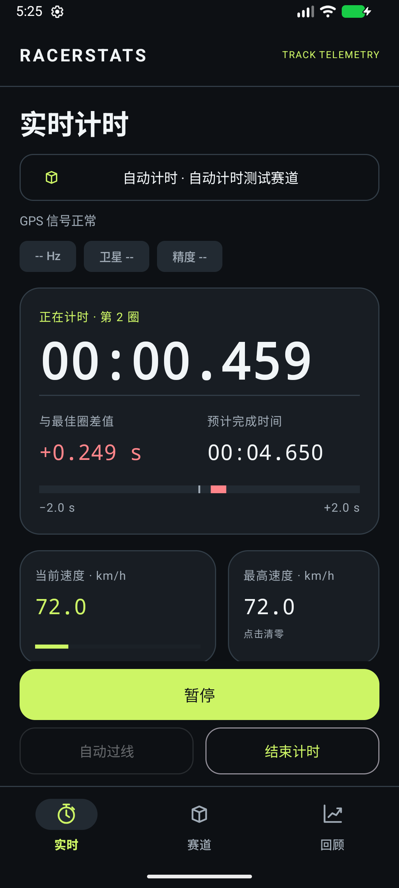
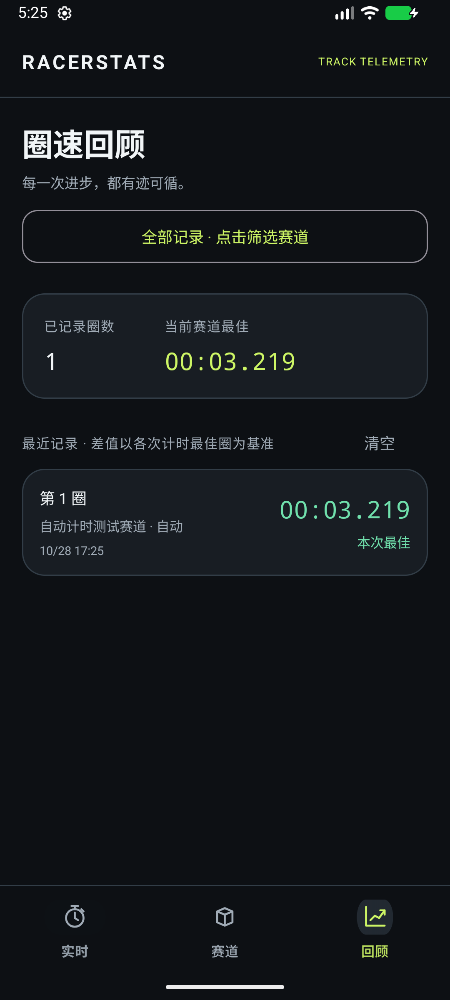
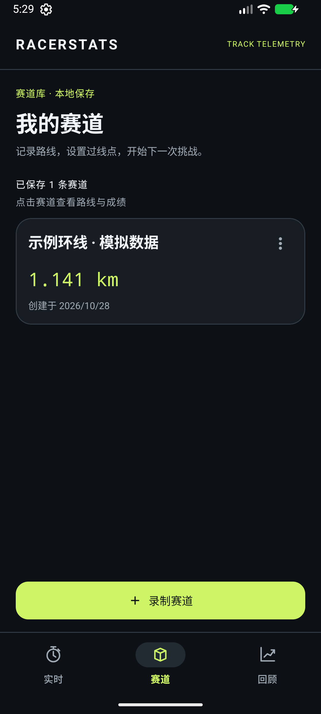
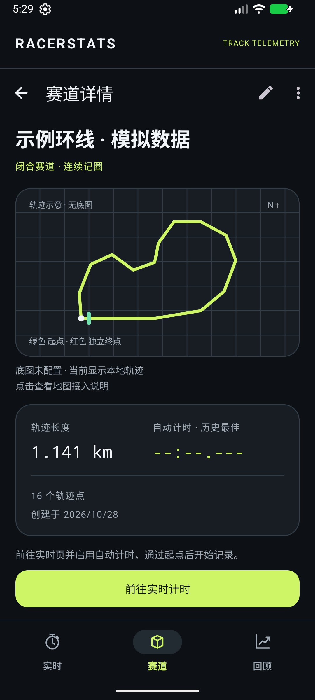
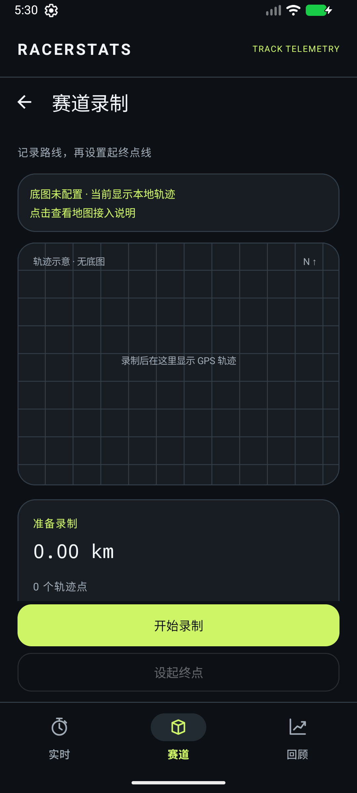
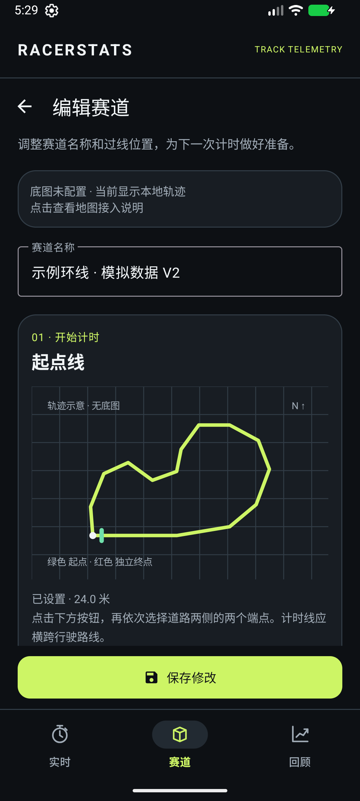

# 项目预览

这些图片来自 RacerStats 在 Android 模拟器中的实际运行，展示深色界面与完整操作入口。赛道、位置和圈速来自合成测试数据，不代表真实驾驶成绩或手机定位精度。

## 实时计时与成绩

| 实时仪表盘 | 圈速回顾 |
| --- | --- |
|  |  |

实时页集中显示计时状态、当前圈、参考圈差值和 GPS 信息，主要操作固定在底部。回顾页按赛道或手动模式筛选，不会把不同赛道成绩混合计算为全局最佳。

## 赛道管理

| 赛道库 | 赛道详情 |
| --- | --- |
|  |  |

列表展示赛道名称、长度与创建信息；详情集中展示路线信息并提供带入当前赛道的自动计时入口。

## 录制与编辑

| 轨迹录制 | 赛道编辑 |
| --- | --- |
|  |  |

地图页面使用未注入 Maps Key 的测试构建，因此展示配置提示和本地北向轨迹示意；示意图没有道路底图，也不提供点击设线。已有赛道仍可查看、改名或进入计时。配置有效 Key 后重新构建安装即可使用底图和地图设线，完整步骤见 [Maps / GPS 接入](maps-gps-integration.md)。手机 GPS 与地图授权分别处理。

## 更新预览

先运行单元测试与设备回归，再在模拟器中打开对应页面截图。当前自动计时设备测试会生成实时 / 回顾截图，赛道页面使用测试赛道进行预览。更新截图时保持文件名一致，并同时检查 README 引用、窄屏布局、长赛道名和空状态。

公开截图仅使用测试数据，不包含真实密钥、个人位置或账号信息。构建和验证命令见 [README](../README.md)。
